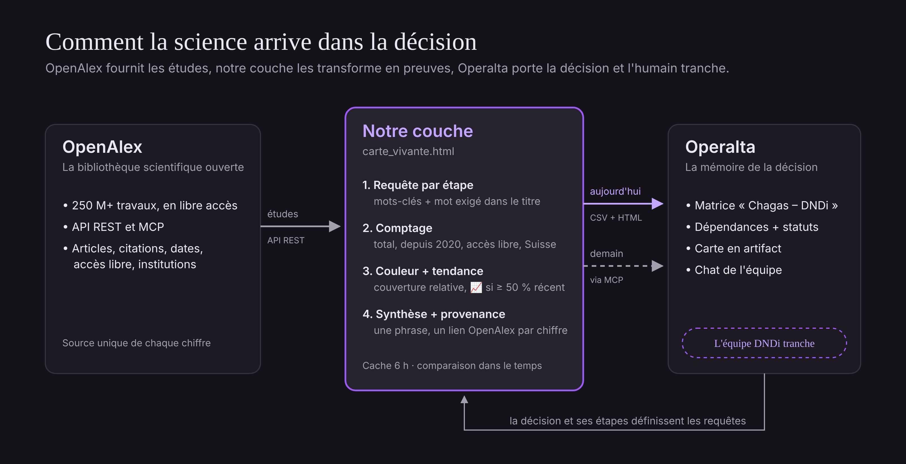

# Carte vivante DNDi × Chagas

**Digital Innovation Week 2026 (UNIGE) · Défi 13 Operalta : relier OpenAlex aux cartes de décision d'Operalta.**

> Question de décision : *Quelle piste de traitement DNDi doit-elle prioriser contre la maladie de Chagas ?*

Nous découpons cette décision en six étapes. Pour chacune, l'outil interroge [OpenAlex](https://openalex.org), compte les études publiées et colore l'étape selon la quantité de preuves disponibles. La carte montre où la décision est solide et où elle avance à l'aveugle. Les résultats alimentent une matrice Operalta, où l'équipe tranche.

> La science ouverte irrigue la décision. Elle ne la remplace pas.

## Démarrer en 1 minute

1. Ouvrir `docs/index.html` dans un navigateur (ou la version en ligne, voir *GitHub Pages* plus bas).
2. Coller sa clé API OpenAlex dans le champ prévu. Elle reste dans le navigateur (localStorage) et n'est jamais écrite dans le dépôt.
3. Lancer l'analyse. Exporter ensuite :
   - `matrice_operalta.csv` pour l'importer dans Operalta ;
   - la version HTML autonome pour l'ajouter comme artifact.

## Contenu du dépôt

| Dossier | Contenu |
|---|---|
| `docs/` | **L'outil principal** : la carte vivante (une seule page HTML, sans installation). Servie par GitHub Pages. |
| `scripts/` | Première version en Python (`carte_dndi.py` → `resultats.json` → `json_vers_csv.py`). Gardée pour l'historique. Elle n'a pas le filtre par mot du titre. |
| `documentation/` | La méthode, l'installation des MCP OpenAlex et Operalta, et le schéma du flux. |
| `data/` | Les exports datés (CSV / JSON) qui servent de preuve dans le pitch. |
| `pitch/` | Le plan chronométré de l'oral. |
| `CLAUDE.md` | Le contexte du projet pour Claude Code (lu automatiquement). |
| `.mcp.json` | Le serveur MCP OpenAlex, partagé par toute l'équipe. |

## Les six étapes

| Étape | Requête OpenAlex | Mot exigé dans le titre |
|---|---|---|
| Besoin médical | `Chagas prevalence` | Chagas |
| Traitements actuels | `Chagas benznidazole` | Chagas |
| Nouvelles molécules | `Trypanosoma cruzi drug discovery` | cruzi |
| Toxicité | `benznidazole adverse effects` | benznidazole |
| Essais cliniques | `Chagas clinical trial` | Chagas |
| Accès / coût | `Chagas treatment gap` | Chagas |

Le détail des couleurs et des limites est dans [documentation/methode.md](documentation/methode.md).

## Travailler avec Claude Code (MCP)

- **OpenAlex** : déclaré dans `.mcp.json`, donc disponible pour toute l'équipe. Dans Claude Code, taper `/mcp` pour se connecter.
- **Operalta** : serveur local en STDIO, à installer sur chaque poste. Voir [documentation/installation-mcp.md](documentation/installation-mcp.md).

## GitHub Pages

Settings → Pages → *Deploy from a branch* → `main` / `/docs`. La carte est alors accessible à l'adresse `https://<compte>.github.io/dndi-chagas-carte-vivante/`. Chaque visiteur saisit sa propre clé OpenAlex.

## Équipe

- [Prénom Nom]
- [Prénom Nom]
- Marwan Ben Mansour

## Sources et attribution

- Données : [OpenAlex](https://openalex.org), licence CC0. Chaque chiffre de la carte renvoie à la requête OpenAlex qui le produit.
- Cas d'usage : scénario réaliste construit à partir de sources publiques. **Non validé avec DNDi.**
- Décisions et matrices : [Operalta](https://www.operalta.ai).
